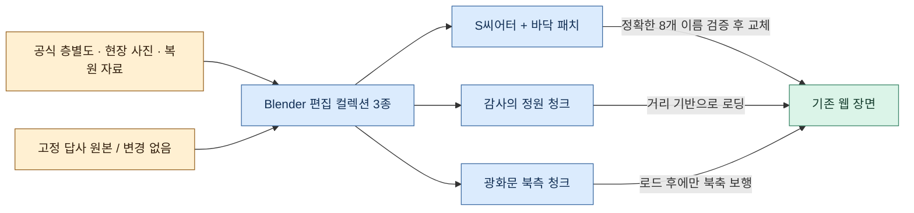
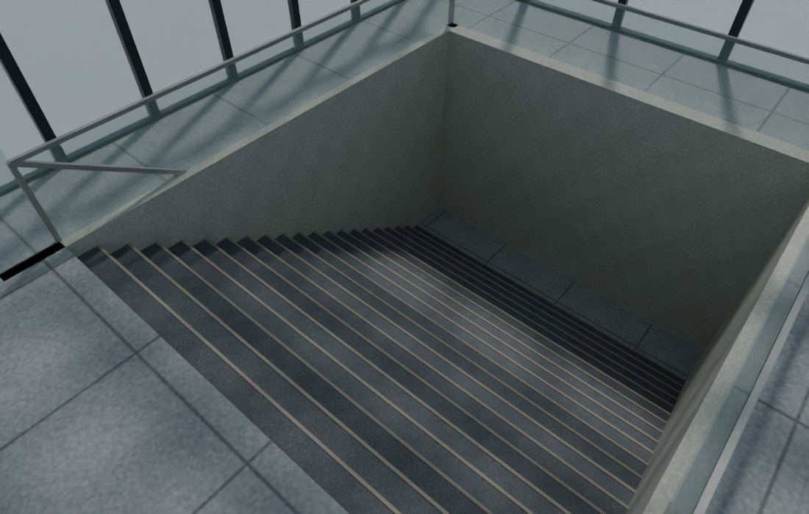
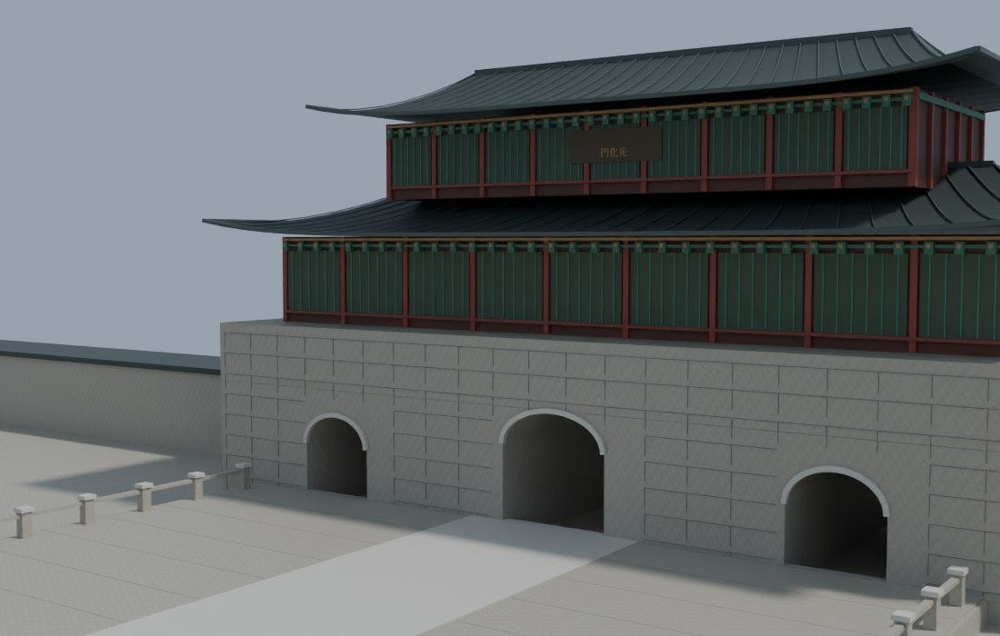

# 2026.11.25. 세종문화회관의 유리 입구와 광화문 북축

`main 82932edb`를 기준으로 한다. 이 작업은 공공 관람 구역을 살펴보는 모형을 위한 보정이다. 시설 안내 또는 현장 실측·시공 도면을 대체하지 않는다. 옛 파일은 삭제하거나 덮어쓰지 않았다.

## 1. 현장에서 보이는 것과 기존 파일의 차이

기존 11월 15일 답사 사본에는 길쭉한 유리 파빌리온과 추정용 실내가 있었다. 웹 기본 코어에는 파빌리온에 해당하는 6개 이름이 있었고, 보행 코드는 높이 +0.23m인 방 하나처럼 처리했다. 건물 앞 계단·예술동·정원과의 위상은 일부 문서에 남아 있었으나, 천장으로 들어온 햇빛이 선큰 계단과 이어지는 차이는 입면이나 걷기에서 느끼기 어려웠다. 별도 `legacy` 모델은 원래 확인 경로로 남긴다.

### 실제 자료와 대응

| 확인 자료 | 이 모델에 반영한 판단 | 여전히 모르는 것 |
| --- | --- | --- |
| [세종문화회관 층별 공간안내](https://www.sejongpac.or.kr/portal/main/contents.do?menuNo=200357), [조감도](https://www.sejongpac.or.kr/static/portal/img/content/img_space_add.png) | 1층 D구역 유리 입구는 예술의 정원과 예술동 쪽이다. 대극장 A와 구분. 광장에서 대극장을 통과해 가야 하는 별도 객석으로 표시하지 않음 | 도식은 치수 도면이 아니다. 칸 너비·계단 깊이·경계의 실측은 없음 |
| [세종문화회관 공식 찾아가는 길](https://www.sejongpac.or.kr/portal/main/contents.do?menuNo=200392), [현장 사진과 동선](https://www.mcst.go.kr/site/s_policy/comm/studentNews/studentNewsView.jsp?pSeq=5136) | 예술의 정원·예술동 및 8번 출구에서 알아볼 수 있는 낮은 외관. 현재 원본 부지 좌표 안에서 본관과 정원 사이 방향을 유지. 기존 지상 상자보다 넓은 유리 그리드와 긴 면 끝쪽 출입부 | 8번 출구 자체의 정확한 입체 모델은 이번 범위 아님 |
| [세종문화회관이 공개한 외관·실내 사진](https://mediahub.seoul.go.kr/archives/1190167), [공식 휠체어 관람 안내](https://www.sejongpac.or.kr/portal/performance/performance/performTicket.do?menuNo=200320&performIdx=36147)와 [기존 답사 사진 관계표](sitevisit-photo-relationships.md) 사진 125·127·128·139 | 짙은 커튼월, 안쪽 밝은 구조재와 투명 유리 지붕, 바닥 개구부, 선큰 계단, 밝은 벽과 반투명 난간을 같이 모델링. 사진 속 입구 상단 가로띠와 바닥 명암 참고 | 실제 엘리베이터는 맞은편 예술동을 쓴다. 이 버전의 모델은 첫 지하 착지까지만 연속 보행이며, 예술동 엘리베이터 연결이나 블랙박스 객석을 구현했다고 주장하지 않음 |
| [서울시 준공 보도자료](https://www.seoul.go.kr/news/news_report.do?nttNo=457765&tr_code=short), [서울시 운영 안내](https://news.seoul.go.kr/culture/archives/532816?listPage=1), [준공 현장과 밤 입구](https://mediahub.seoul.go.kr/archives/2018223), [정원 위치 현장 기사](https://mediahub.seoul.go.kr/archives/2018143) | 2026-05-12 개장한 공간. 세종로공원 쪽, 남북으로 이어진 6.25m 조형 23개. 미국이 남단, 대한민국이 북단. 실제 사진의 낮은 발, 오목한 곡선, 석재 수평 이음, 어두운 인서트, 난간 가장자리의 빛에 맞춤 | 각 조형의 간격·석재 산지 색·국기 및 문구를 모두 실측하지 않음. 프리덤 홀 입구는 모델링, 미디어 전시장 전체는 아님 |
| [서울시 광장 시설지도](https://uri.seoul.go.kr/ghm/facility/list.do?codeId=CODE_06&mid=1011&siteGrpKey=ghm&siteId=ghm), [국가유산청 월대 기록](https://khs.go.kr/cop/bbs/selectBoardArticle.do?bbsId=BBSMSTR_1008&mn=NS_01_09_01&nttId=87185), [복원 사진 자료](https://www.gogung.go.kr/gogung/cmmn/file/fileDown.do?atchFileId=3bbe9a9f1fff4afdbe9da9a9bb351918&fileSn=2&menuNo=800105), [광화문 지리 앵커](https://www.wikidata.org/wiki/Q485034) | 광장 북단의 공공 축, 직각이 아닌 북쪽 진입 방향, 횡단보도, 약 30m 폭 월대와 약 7m 중앙 어도, 좌우 석난간, 세 홍예, 두 층의 옥개를 제작. 월대는 약 49m 범위를 시각 기준으로 사용 | 광장 도로·신호·수목과 궁궐 전체의 실측이 아니다. 석수와 처마 세부는 미완. 광화문 현판은 [복원 당시 자료](https://www.yna.co.kr/view/AKR20231015048600005)를 참고한 글자 디자인으로, 원필획 복제가 아님 |

S씨어터의 층 표기는 건축 층과 공연장 객석 층을 섞으면 달라 보인다. 공식 공간도상 **지상 1층은 출입부**이고 공연 운영 안내는 **지하 2층 로비/안내**를 별도로 가리킨다. 지도를 근거로 출입부의 상대 관계를 재구성하고, 공개 이동 범위만 만들었다. 고객용 사진, 기자 사진, PDF 원본은 GitHub에 새로 올리지 않았다.

## 2. 모델링, 포장, 웹 자산

- **좌표:** 원본 Blender는 +X 북, +Y 서, +Z 상을 쓰고 웹은 (X,Z,−Y)다. 광화문 기준점은 위키데이터 점을 기존 EPSG:5186 함수로 바꾼 약 (413.324, 72.957)이다. 이는 실제 위치에 근거한 앵커지만 벽 모서리 좌표는 아니다. 기존 광장이 X=240 부근에서 끊기므로 거기를 연장해 원래 회관과 문루를 같은 장면에 연결한다.
- **S씨어터:** 포털과 검은 세로 멀리언, 수평 트랜섬·천창, 층고 5.95m 근사 볼륨을 별도 형상에서 제작했다. 출입문을 페인트로 그리지 않고 한쪽 낮은 유리와 프레임을 실제로 비웠다. 아래쪽은 20단과 하부 착지, 상부 안전 난간을 모델링했다. 사진에서 확인되지 않은 공연장까지는 연결하지 않았다. 지하가 가짜로 막히지 않게 두 원래 지면의 교차 섬만 잘랐다. 예술의 정원/해치마당/프리덤 홀 쪽 다른 구멍·포장은 원본 좌표대로 유지한다.
- **감사의 빛:** 컷 석재를 누적 배치하되 각 조형 안에는 한 덩어리처럼 겹친 표면을 남기지 않고 층을 나눴다. 단면 높이와 내부곡선을 반복 샘플해 좁은 조인트와 화강암 톤의 미립도를 추가했다. 프리덤 홀 계단·입구 벽·기존 유리와 물길 보행교를 유지하고 조명 띠를 보강했다. 지상의 조형과 지하 해치마당을 하나로 합치지 않는다.
- **광화문:** 지역 GLB를 블록으로 또 만드는 대신 석재 담·3개 홍예·월대 층단·어도로 이어지는 동선을 구분했다. 처마 높이는 중앙 능선과 네 모서리를 다르게 계산한 곡면이며, 기와 끝과 골을 별도 메시에 적산했다. 두 층은 색 띠와 창살, 옥개 폭이 따로 있다. 보행은 모델이 실제 보이는 상태에서 북측 횡단보도와 문턱 앞 월대까지만 허용한다.
- **재질:** 직접 생성한 작은 JPEG 타일을 Blender에 pack하고, GLB에 내장한다. 석재·광장 바닥·아스팔트·기와·계단 재질은 독립 UV 주기. 원본 사진을 텍스처로 자르지 않았다. 창은 단일 색상 상자가 아닌 프레임과 별도 유리이며, 다른 입력 없이 표준 glTF 알파·금속·거칠기로 표시한다. 실사 유리 굴절·반사 환경의 완전한 재현은 아니다.



## 3. 기존 장면을 깨지 않도록 한 선택

기존 16,771,192B 코어를 그대로 유지한다. 3종 편집 컬렉션은 `blender_work/20261125-public-axis/sejong_public_axis_components.blend` 한 파일에 있다. `build_public_axis.py`는 고정 11월 15일 원본에서 오직 기존 두 지면과 공개 프리덤 입구/보행교 메시만 읽어 새 파일을 만든다. 원본 Git blob `9104c40f…`과 해시가 맞는 파일을 사용했다. 원본 전체를 이전 버전에서 저장하면 데이터 손실 경고가 나오므로 저장하지 않았다. 이번에 편집 가능한 것은 추출·제작한 컬렉션이며 전체 시내 장면을 다시 저장한 파일은 아니다.

| 모델 | 전송 파일 크기 | 실행 방식 |
| --- | ---: | --- |
| S씨어터, 새 바닥 | 321,244 B | 기본 코어와 병렬 요청. GLB 구조와 정확한 기존 이름 8개가 맞을 때만 교체 |
| 감사의 정원 | 176,408 B | 이전 154,044 B 청크를 같은 거리 규칙으로 교체, +22,364 B |
| 광화문 북축 | 297,864 B | 북쪽에 가까워지거나 시점을 맞춘 경우만 요청. 기존 시작 각도 유지 |

기존 후면 정원 청크에는 바닥·가구·포스터가 들어간 11개 옛 S씨어터 실내 메시가 따로 있었다. 첫 웹 렌더의 새 유리 뒤로 옛 판넬이 삐져나온 것을 보고 청크 노드를 조사했다. 새 패치가 성공한 경우에 한해서 이 11개 이름만 숨긴다. 정원 및 기존 모델 실패 시 경로는 유지된다. 첫 버전의 진한 UV 반복은 원본 현장 사진보다 과하고 축소 시 빗살처럼 보였다. 같은 출력 카메라에서 석재 색을 밝히고 저주파 패턴의 대비, 노이즈 크기와 질감 반복을 조정했다. 2018년과 2026년 사진에서 공통으로 보이는 독립 노란 S 표시도 추가했다.

원경 장식의 기존 렌더 예산을 바꾸지 않았다. 이번 S씨어터 패치는 오버헤드가 있으므로 새 사이트 초기 표시가 빨라졌다고 주장하지 않는다. Web GLB의 석재 UV는 `gltfpack` 기본 양자화에서 경고가 나 조밀한 석재 패턴이 변형될 여지가 있었다. 두 스트리밍 청크에 `-vtf`로 수정했다. 정원 청크 노드 수는 패킹에 따른 변환 노드를 포함하므로 그대로 draw call 수가 아니다. 메시에 반복 요소를 묶었어도 전체 FPS는 보장하지 않는다.

## 4. 재현과 검증

```sh
npm ci
node --test tests/*.test.js
npm run build
blender -b --factory-startup --disable-autoexec -t 4 --python-exit-code 1 \
  -P scripts/build_public_axis.py -- --gltfpack /path/to/gltfpack
python scripts/refresh_public_axis_manifest.py
blender -b --factory-startup --disable-autoexec -t 4 --python-exit-code 1 \
  -P scripts/check_public_axis_blender.py -- --source path/to/source.blend --output /tmp/sejong-axis-check
```

Blender 5.0.1에서 고정 원본을 읽어 이전 평면과 바뀐 보행 지면의 여섯 높이, 물길 보행교 유지, 조형 23개, 문루·현판 메시를 확인했다. 공개 지면의 형상과 코드상의 높이는 별개로 검사했다. 경계선/문 사이를 막는 경우와 열린 경우, 신규 GLB를 받지 못하면 구형 모델이 유지되는 경우, manifest와 실제 GLB 해시 일치를 단위 테스트로 본다. Blender `--render`에서 비교 카메라를 쓸 수 있고, 웹 테스트는 `tests/public-axis-browser.cjs`에서 실제 뷰어를 구동한다.

### 브라우저에서 확인한 흐름

정적 production 빌드를 Chromium 131/SwiftShader에서 `/explore/`로 열었다. 낮 모드를 고정하고 똑같은 카메라 프리셋에서 기존 manifest와 새 manifest를 각각 사용했다. 전후의 자산 URL 및 HTTP 200, WebGL 캔버스 한 개, 390px에서 가로 오버플로가 없는지 확인했다. S씨어터 패치에만 404를 주었을 때 기존 유리 모형으로 돌아왔고, 다른 조작이 멈추거나 자바스크립트 예외가 생기지 않았다. 초기 390px 화면에서는 기존 버튼 그룹에 세 장소를 나란히 추가하니 글자가 세로로 접혔다. 장소 셋을 하나의 **장소 바로 보기** 선택기로 합치고, 원래 조명·정면·뒷면·처음 시점은 두 줄로 자연스럽게 배치하도록 수정했다. 가로 전체 폭뿐 아니라 각 컨트롤 경계가 뷰어 안에 드는지 별도로 검사했다.

장소를 선택한 후 직접 걷기로 바꾸면 S씨어터 또는 광화문의 새 모델이 준비됐을 때 입구 바깥이나 횡단보도 앞에서 시작한다. 새 지면을 읽지 못한 경우에는 기존 시작점 그대로다. 이 전환과 보행 수학의 회귀는 검사했으며, 브라우저 실기기에서 모든 걸음과 실제 현장 접근성을 보증하지는 않는다.

본 회차 최종 JavaScript 단위 테스트 142/142, Vite production build 통과. 기존 500kB 번들 경고는 여전히 있고 브라우저는 실기기 대신 로컬 소프트웨어 WebGL이었다. 테스트 도구는 환경에 설치한 Playwright를 쓰거나 `PLAYWRIGHT_PATH`로 가리킨다. 이 PR을 자동으로 main에 넣거나 운영 배포를 변경하지 않았다.

## 5. 전후 브라우저 화면과 Blender 스틸

사진 자료가 아니라 **직접 만든 모델의 출력**만 아래에 게시한다. 웹 화면은 같은 낮 모드·같은 각도다. 전은 기존 asset manifest를 사용하되 비교 시점은 동일하게 맞췄다. 광화문 전 화면에서 북쪽이 비는 것은 그 장소까지 원래 모델이 없었기 때문이다.

| 위치 | 기존 브라우저 화면 | 보정 뒤 브라우저 화면 |
| --- | --- | --- |
| S씨어터 | [기존 평면 파빌리온](public-axis-20261125/web-theatre-before.jpg) | [멀리언과 진입구](public-axis-20261125/web-theatre-after.jpg) |
| 감사의 정원 | [기존 석조 모형](public-axis-20261125/web-gratitude-before.jpg) | [이음과 곡면](public-axis-20261125/web-gratitude-after.jpg) |
| 광화문 북단 | [연결 전](public-axis-20261125/web-north-before.jpg) | [월대와 새 북축](public-axis-20261125/web-north-after.jpg) · [390px 컨트롤](public-axis-20261125/web-north-mobile.jpg) |

세부 스틸은 편집용 Blender 컬렉션을 Cycles로 별도 렌더했다. 도시 배경이 생략된 대조용 화면이다. `scripts/render_public_axis_stills.py`로 같은 장면 및 조명을 다시 뽑을 수 있다.






## 6. 남겨 둔 부분

정밀 실측, 공연장 객석/예술동 엘리베이터, 프리덤 홀 미디어 월과 가동 중인 전시, 새로 참여한 국가별 실물 석재, 실물 단청 문양 전체, 어도 앞 석수, 북쪽 궁궐과 차도 교통은 후속 범위다. 전 구간 성능·실기기와 운영 액세스 안의 동작은 별도 검증해야 한다. 이 기록에서 확인된 장면과 추정값을 섞어서 인허가·안전·현장 안내에 사용하면 안 된다.
