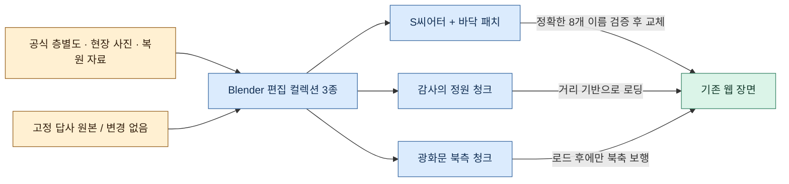
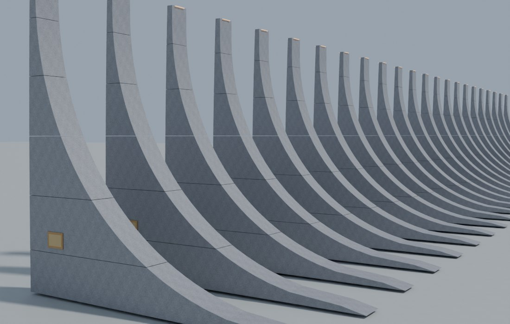
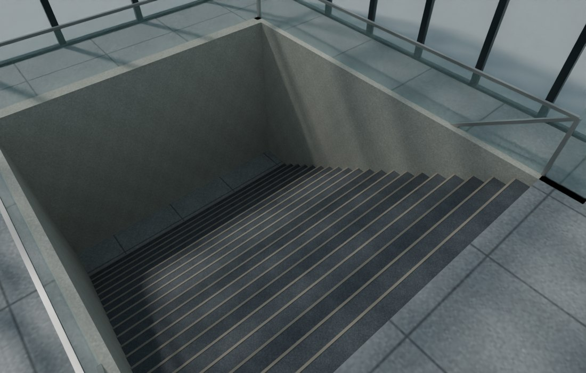
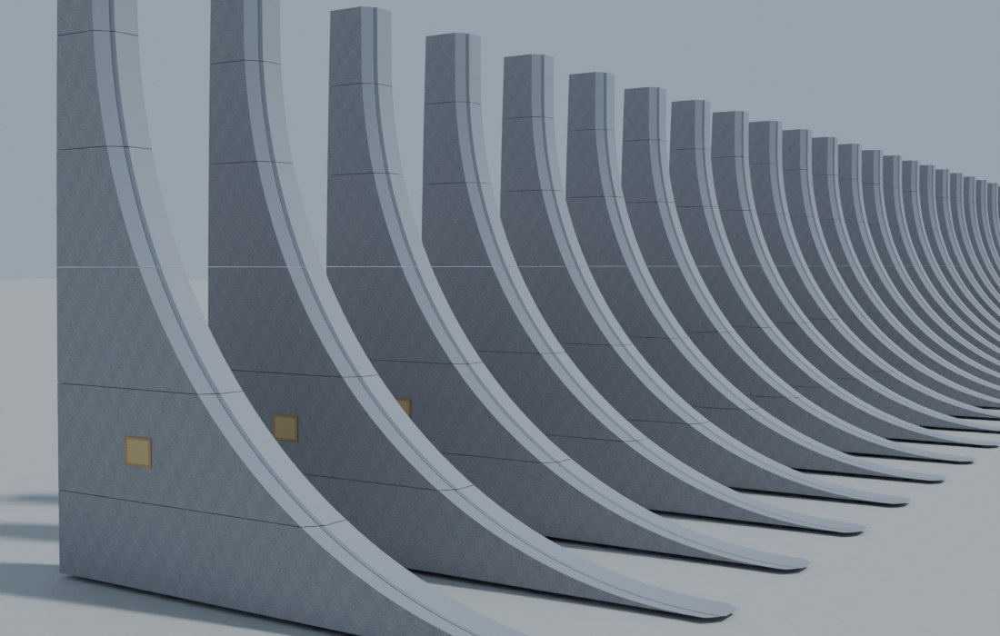
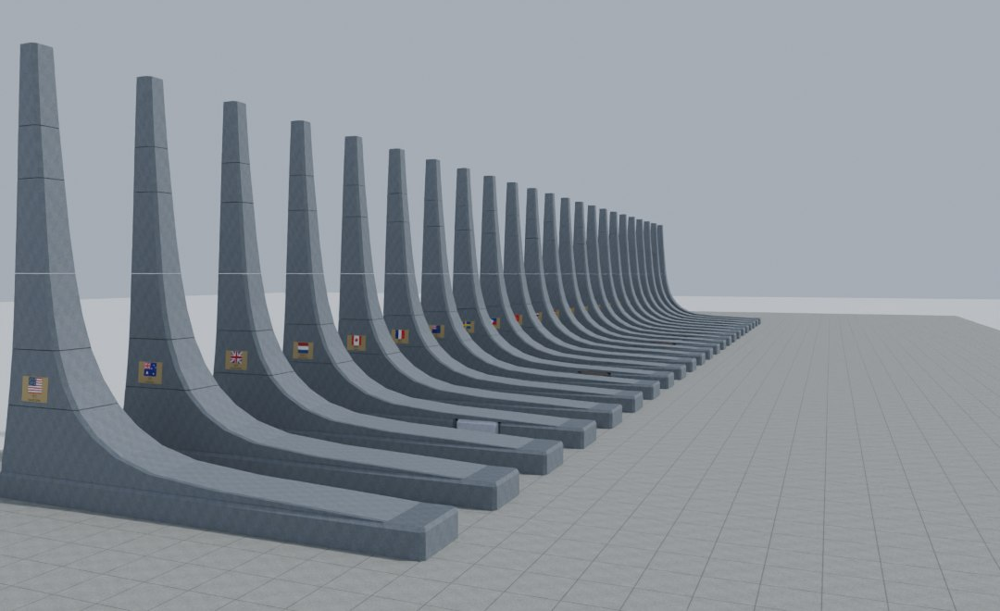
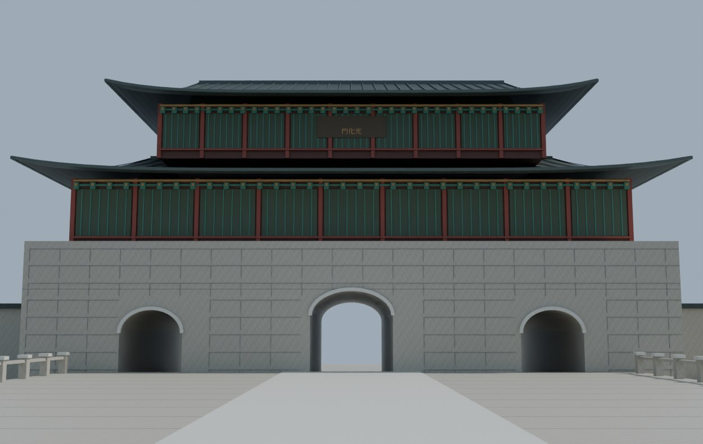
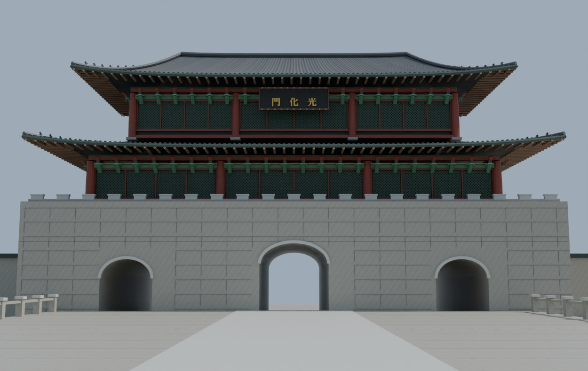
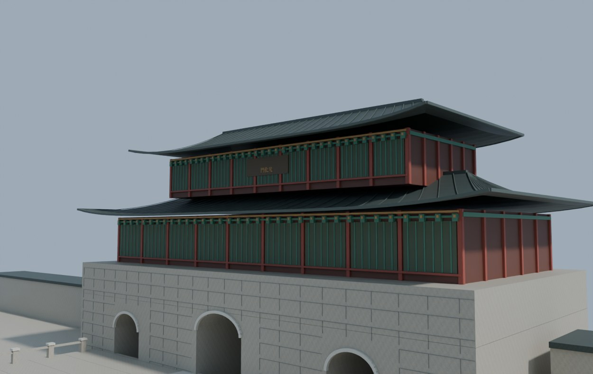
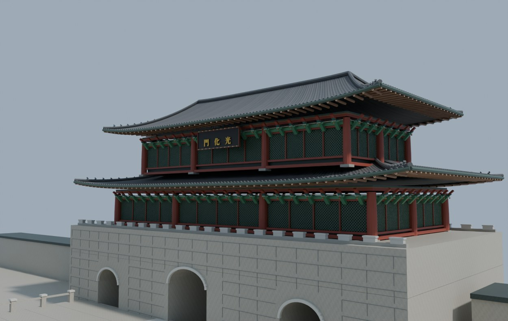

# 2026.11.25. 세종문화회관의 유리 입구와 광화문 북축

`main 82932edb`를 기준으로 한다. 이 작업은 공공 관람 구역을 살펴보는 모형을 위한 보정이다. 시설 안내 또는 현장 실측·시공 도면을 대체하지 않는다. 옛 파일은 삭제하거나 덮어쓰지 않았다.

## 1. 현장에서 보이는 것과 기존 파일의 차이

기존 11월 15일 답사 사본에는 길쭉한 유리 파빌리온과 추정용 실내가 있었다. 웹 기본 코어에는 파빌리온에 해당하는 6개 이름이 있었고, 보행 코드는 높이 +0.23m인 방 하나처럼 처리했다. 건물 앞 계단·예술동·정원과의 위상은 일부 문서에 남아 있었으나, 천장으로 들어온 햇빛이 선큰 계단과 이어지는 차이는 입면이나 걷기에서 느끼기 어려웠다. 별도 `legacy` 모델은 원래 확인 경로로 남긴다.

### 실제 자료와 대응

| 확인 자료 | 이 모델에 반영한 판단 | 여전히 모르는 것 |
| --- | --- | --- |
| [세종문화회관 층별 공간안내](https://www.sejongpac.or.kr/portal/main/contents.do?menuNo=200357), [조감도](https://www.sejongpac.or.kr/static/portal/img/content/img_space_add.png) | 1층 D구역 유리 입구는 예술의 정원과 예술동 쪽이다. 대극장 A와 구분. 광장에서 대극장을 통과해 가야 하는 별도 객석으로 표시하지 않음 | 도식은 치수 도면이 아니다. 칸 너비·계단 깊이·경계의 실측은 없음 |
| [세종문화회관 공식 찾아가는 길](https://www.sejongpac.or.kr/portal/main/contents.do?menuNo=200392), [현장 사진과 동선](https://www.mcst.go.kr/site/s_policy/comm/studentNews/studentNewsView.jsp?pSeq=5136) | 예술의 정원·예술동 및 8번 출구에서 알아볼 수 있는 낮은 외관. 현재 원본 부지 좌표 안에서 본관과 정원 사이 방향을 유지. 기존 지상 상자보다 넓은 유리 그리드와 긴 면 끝쪽 출입부 | 8번 출구 자체의 정확한 입체 모델은 이번 범위 아님 |
| [세종문화회관이 공개한 외관·실내 사진](https://mediahub.seoul.go.kr/archives/1190167), [공식 휠체어 관람 안내](https://www.sejongpac.or.kr/portal/performance/performance/performTicket.do?menuNo=200320&performIdx=36147)와 [기존 답사 사진 관계표](sitevisit-photo-relationships.md) 사진 125·127·128·139 | 짙은 커튼월, 안쪽 밝은 구조재와 투명 유리 지붕, 바닥 개구부, 선큰 계단, 밝은 벽과 반투명 난간을 같이 모델링. 사진 속 입구 상단 가로띠와 바닥 명암 참고 | 실제 엘리베이터는 맞은편 예술동을 쓴다. 이 버전의 모델은 첫 지하 착지까지만 연속 보행이며, 예술동 엘리베이터 연결이나 블랙박스 객석을 구현했다고 주장하지 않음 |
| [서울시 준공 보도자료](https://www.seoul.go.kr/news/news_report.do?nttNo=457765&tr_code=short), [서울시 운영 안내](https://news.seoul.go.kr/culture/archives/532816?listPage=1), [준공 현장과 밤 입구](https://mediahub.seoul.go.kr/archives/2018223), [정원 위치 현장 기사](https://mediahub.seoul.go.kr/archives/2018143) | 2026-05-12 개장한 공간. 세종로공원 쪽, 남북으로 이어진 6.25m 조형 23개. 미국이 남단, 대한민국이 북단. 실제 사진의 낮은 발, 오목한 곡선, 석재 수평 이음, 어두운 인서트, 난간 가장자리의 빛에 맞춤 | 각 조형의 간격·석재 산지 색·국기 및 문구를 모두 실측하지 않음. 프리덤 홀 입구는 모델링, 미디어 전시장 전체는 아님 |
| [서울시 광장 시설지도](https://uri.seoul.go.kr/ghm/facility/list.do?codeId=CODE_06&mid=1011&siteGrpKey=ghm&siteId=ghm), [국가유산청 월대 기록](https://khs.go.kr/cop/bbs/selectBoardArticle.do?bbsId=BBSMSTR_1008&mn=NS_01_09_01&nttId=87185), [복원 사진 자료](https://www.gogung.go.kr/gogung/cmmn/file/fileDown.do?atchFileId=3bbe9a9f1fff4afdbe9da9a9bb351918&fileSn=2&menuNo=800105), [광화문 지리 앵커](https://www.wikidata.org/wiki/Q485034) | 광장 북단의 공공 축, 직각이 아닌 북쪽 진입 방향, 횡단보도, 약 30m 폭 월대와 약 7m 중앙 어도, 좌우 석난간, 세 홍예, 두 층의 옥개를 제작. 월대는 약 49m 범위를 시각 기준으로 사용 | 광장 도로·신호·수목과 궁궐 전체의 실측이 아니다. 석수와 처마 세부는 미완. 광화문 현판은 [복원 당시 자료](https://www.yna.co.kr/view/AKR20231015048600005)를 참고한 글자 디자인으로, 원필획 복제가 아님 |

S씨어터의 층 표기는 건축 층과 공연장 객석 층을 섞으면 달라 보인다. 공식 공간도상 **지상 1층은 출입부**이고 공연 운영 안내는 **지하 2층 로비/안내**를 별도로 가리킨다. 지도를 근거로 출입부의 상대 관계를 재구성하고, 공개 이동 범위만 만들었다. 고객용 사진, 기자 사진, PDF 원본은 GitHub에 새로 올리지 않았다.

## 2. 모델링, 포장, 웹 자산

- **좌표:** 원본 Blender는 +X 북, +Y 서, +Z 상을 쓰고 웹은 (X,Z,−Y)다. 광화문 기준점은 위키데이터 점을 기존 EPSG:5186 함수로 바꾼 약 (413.324, 72.957)이다. 이는 실제 위치에 근거한 앵커지만 벽 모서리 좌표는 아니다. 기존 광장이 X=240 부근에서 끊기므로 거기를 연장해 원래 회관과 문루를 같은 장면에 연결한다.
- **S씨어터:** 포털과 검은 세로 멀리언, 수평 트랜섬·천창, 층고 5.95m 근사 볼륨을 별도 형상에서 제작했다. 출입문을 페인트로 그리지 않고 한쪽 낮은 유리와 프레임을 실제로 비웠다. 아래쪽은 20단과 하부 착지, 상부 안전 난간을 모델링했다. 사진에서 확인되지 않은 공연장까지는 연결하지 않았다. 지하가 가짜로 막히지 않게 두 원래 지면의 교차 섬만 잘랐다. 예술의 정원/해치마당/프리덤 홀 쪽 다른 구멍·포장은 원본 좌표대로 유지한다.
- **감사의 빛:** 컷 석재를 누적 배치하되 각 조형 안에는 한 덩어리처럼 겹친 표면을 남기지 않고 층을 나눴다. 단면 높이와 내부곡선을 반복 샘플해 좁은 조인트와 화강암 톤의 미립도를 추가했다. 프리덤 홀 계단·입구 벽·기존 유리와 물길 보행교를 유지하고 조명 띠를 보강했다. 지상의 조형과 지하 해치마당을 하나로 합치지 않는다.
- **광화문:** 지역 GLB를 블록으로 또 만드는 대신 석재 담·3개 홍예·월대 층단·어도로 이어지는 동선을 구분했다. 처마 높이는 중앙 능선과 네 모서리를 다르게 계산한 곡면이며, 기와 끝과 골을 별도 메시에 적산했다. 두 층은 색 띠와 창살, 옥개 폭이 따로 있다. 보행은 모델이 실제 보이는 상태에서 북측 횡단보도와 문턱 앞 월대까지만 허용한다.
- **재질:** 직접 생성한 작은 JPEG 타일을 Blender에 pack하고, GLB에 내장한다. 석재·광장 바닥·아스팔트·기와·계단 재질은 독립 UV 주기. 원본 사진을 텍스처로 자르지 않았다. 창은 단일 색상 상자가 아닌 프레임과 별도 유리이며, 다른 입력 없이 표준 glTF 알파·금속·거칠기로 표시한다. 실사 유리 굴절·반사 환경의 완전한 재현은 아니다.



## 3. 기존 장면을 깨지 않도록 한 선택

기존 16,771,192B 코어를 그대로 유지한다. 3종 편집 컬렉션은 `blender_work/20261125-public-axis/sejong_public_axis_components.blend` 한 파일에 있다. `build_public_axis.py`는 고정 11월 15일 원본에서 오직 기존 두 지면과 공개 프리덤 입구/보행교 메시만 읽어 새 파일을 만든다. 원본 Git blob `9104c40f…`과 해시가 맞는 파일을 사용했다. 원본 전체를 이전 버전에서 저장하면 데이터 손실 경고가 나오므로 저장하지 않았다. 이번에 편집 가능한 것은 추출·제작한 컬렉션이며 전체 시내 장면을 다시 저장한 파일은 아니다.

| 모델 | 전송 파일 크기 | 실행 방식 |
| --- | ---: | --- |
| S씨어터, 새 바닥 | 321,244 B | 기본 코어와 병렬 요청. GLB 구조와 정확한 기존 이름 8개가 맞을 때만 교체 |
| 감사의 정원 | 176,408 B | 이전 154,044 B 청크를 같은 거리 규칙으로 교체, +22,364 B |
| 광화문 북축 | 297,864 B | 북쪽에 가까워지거나 시점을 맞춘 경우만 요청. 기존 시작 각도 유지 |

기존 후면 정원 청크에는 바닥·가구·포스터가 들어간 11개 옛 S씨어터 실내 메시가 따로 있었다. 첫 웹 렌더의 새 유리 뒤로 옛 판넬이 삐져나온 것을 보고 청크 노드를 조사했다. 새 패치가 성공한 경우에 한해서 이 11개 이름만 숨긴다. 정원 및 기존 모델 실패 시 경로는 유지된다. 첫 버전의 진한 UV 반복은 원본 현장 사진보다 과하고 축소 시 빗살처럼 보였다. 같은 출력 카메라에서 석재 색을 밝히고 저주파 패턴의 대비, 노이즈 크기와 질감 반복을 조정했다. 2018년과 2026년 사진에서 공통으로 보이는 독립 노란 S 표시도 추가했다.

원경 장식의 기존 렌더 예산을 바꾸지 않았다. 이번 S씨어터 패치는 오버헤드가 있으므로 새 사이트 초기 표시가 빨라졌다고 주장하지 않는다. Web GLB의 석재 UV는 `gltfpack` 기본 양자화에서 경고가 나 조밀한 석재 패턴이 변형될 여지가 있었다. 두 스트리밍 청크에 `-vtf`로 수정했다. 정원 청크 노드 수는 패킹에 따른 변환 노드를 포함하므로 그대로 draw call 수가 아니다. 메시에 반복 요소를 묶었어도 전체 FPS는 보장하지 않는다.

## 4. 재현과 검증

```sh
npm ci
node --test tests/*.test.js
npm run build
blender -b --factory-startup --disable-autoexec -t 4 --python-exit-code 1 \
  -P scripts/build_public_axis.py -- --gltfpack /path/to/gltfpack
python scripts/refresh_public_axis_manifest.py
blender -b --factory-startup --disable-autoexec -t 4 --python-exit-code 1 \
  -P scripts/check_public_axis_blender.py -- --source path/to/source.blend --output /tmp/sejong-axis-check
```

Blender 5.0.1에서 고정 원본을 읽어 이전 평면과 바뀐 보행 지면의 여섯 높이, 물길 보행교 유지, 조형 23개, 문루·현판 메시를 확인했다. 공개 지면의 형상과 코드상의 높이는 별개로 검사했다. 경계선/문 사이를 막는 경우와 열린 경우, 신규 GLB를 받지 못하면 구형 모델이 유지되는 경우, manifest와 실제 GLB 해시 일치를 단위 테스트로 본다. Blender `--render`에서 비교 카메라를 쓸 수 있고, 웹 테스트는 `tests/public-axis-browser.cjs`에서 실제 뷰어를 구동한다.

### 브라우저에서 확인한 흐름

정적 production 빌드를 Chromium 131/SwiftShader에서 `/explore/`로 열었다. 낮 모드를 고정하고 똑같은 카메라 프리셋에서 기존 manifest와 새 manifest를 각각 사용했다. 전후의 자산 URL 및 HTTP 200, WebGL 캔버스 한 개, 390px에서 가로 오버플로가 없는지 확인했다. S씨어터 패치에만 404를 주었을 때 기존 유리 모형으로 돌아왔고, 다른 조작이 멈추거나 자바스크립트 예외가 생기지 않았다. 초기 390px 화면에서는 기존 버튼 그룹에 세 장소를 나란히 추가하니 글자가 세로로 접혔다. 장소 셋을 하나의 **장소 바로 보기** 선택기로 합치고, 원래 조명·정면·뒷면·처음 시점은 두 줄로 자연스럽게 배치하도록 수정했다. 가로 전체 폭뿐 아니라 각 컨트롤 경계가 뷰어 안에 드는지 별도로 검사했다.

장소를 선택한 후 직접 걷기로 바꾸면 S씨어터 또는 광화문의 새 모델이 준비됐을 때 입구 바깥이나 횡단보도 앞에서 시작한다. 새 지면을 읽지 못한 경우에는 기존 시작점 그대로다. 이 전환과 보행 수학의 회귀는 검사했으며, 브라우저 실기기에서 모든 걸음과 실제 현장 접근성을 보증하지는 않는다.

본 회차 최종 JavaScript 단위 테스트 142/142, Vite production build 통과. 기존 500kB 번들 경고는 여전히 있고 브라우저는 실기기 대신 로컬 소프트웨어 WebGL이었다. 테스트 도구는 환경에 설치한 Playwright를 쓰거나 `PLAYWRIGHT_PATH`로 가리킨다. 이 PR을 자동으로 main에 넣거나 운영 배포를 변경하지 않았다.

## 5. 전후 브라우저 화면과 Blender 스틸

사진 자료가 아니라 **직접 만든 모델의 출력**만 아래에 게시한다. 웹 화면은 같은 낮 모드·같은 각도다. 전은 기존 asset manifest를 사용하되 비교 시점은 동일하게 맞췄다. 광화문 전 화면에서 북쪽이 비는 것은 그 장소까지 원래 모델이 없었기 때문이다.

| 위치 | 기존 브라우저 화면 | 보정 뒤 브라우저 화면 |
| --- | --- | --- |
| S씨어터 | [기존 평면 파빌리온](public-axis-20261125/web-theatre-before.jpg) | [멀리언과 진입구](public-axis-20261125/web-theatre-after.jpg) |
| 감사의 정원 | [기존 석조 모형](public-axis-20261125/web-gratitude-before.jpg) | [이음과 곡면](public-axis-20261125/web-gratitude-after.jpg) |
| 광화문 북단 | [연결 전](public-axis-20261125/web-north-before.jpg) | [월대와 새 북축](public-axis-20261125/web-north-after.jpg) · [390px 컨트롤](public-axis-20261125/web-north-mobile.jpg) |

세부 스틸은 편집용 Blender 컬렉션을 Cycles로 별도 렌더했다. 도시 배경이 생략된 대조용 화면이다. `scripts/render_public_axis_stills.py`로 같은 장면 및 조명을 다시 뽑을 수 있다.





## 6. 남겨 둔 부분

정밀 실측, 공연장 객석/예술동 엘리베이터, 프리덤 홀 미디어 월과 가동 중인 전시, 새로 참여한 국가별 실물 석재, 실물 단청 문양 전체, 어도 앞 석수, 북쪽 궁궐과 차도 교통은 후속 범위다. 전 구간 성능·실기기와 운영 액세스 안의 동작은 별도 검증해야 한다. 이 기록에서 확인된 장면과 추정값을 섞어서 인허가·안전·현장 안내에 사용하면 안 된다.

## 7. 현장 대조 재작업: 반대편 입구와 감사의 빛 23

첫 버전은 `8f489ebe`로 병합되어 Cloudflare Pages production에서 배포된 것을 확인했다. 아래는 그 시점에 호세가 지적한 두 오류에 대한 후속 변경이다. 위의 렌더와 수치는 앞 버전의 작업 기록이므로 삭제하지 않는다.

### S씨어터: 사진의 좌우를 모델 축에 매핑

[1층 공식 안내도](https://www.sejongpac.or.kr/static/portal/img/content/img_space_add.png)에서 D(유리 입구)와 H(예술동) 사이의 통행 관계를 확인하고, [동일 투영의 공식 주차장 진입 안내도](https://www.sejongpac.or.kr/static/portal/img/content/parking_0104.gif)에 적힌 광화문·광장·8번 출구로 방위를 설정했다. 광화문이 북측임을 기준으로 보면, 관람객이 예술동 쪽에서 마주보는 면은 모델의 **+X, 북쪽 긴 면**이다. [2018년 세종문화회관 공개 외관](https://mediahub.seoul.go.kr/wp-content/uploads/2018/10/737e327f2c72449652c283a78bfde5aa.jpg)과 [공개 입구 내부 사진](https://mediahub.seoul.go.kr/wp-content/uploads/2018/10/dba6814d14f1f5545faecd31fa91e1f4.jpg), [답사 사진 127 및 관계표](sitevisit-photo-relationships.md)를 비교했다. 사진을 보는 사람의 오른쪽, 노란 S 가까이에 유리문이 있고 반대쪽에 돌계단이 있다.

처음에는 남쪽 면을 기준으로 사진 오른쪽을 해석해 문을 같은 면에서 반대쪽 끝으로 옮겨봤다. 방위 표기가 있는 두 번째 자료를 겹쳐 보니 그 가설은 틀렸다. 최종본은 건물 장축을 유지한 채 문을 반대 면으로 옮겼다. 북쪽으로부터 남쪽을 바라보면 사진 오른쪽이 Blender +Y라, 유리면 길이의 약 81~94% 지점에 문을 배치했다. 새 모델의 문은 **X=36.5m, Y=120.35~121.85m**이고 폭 약 1.50m이며 기존 추정 1.46m와 비슷하다. 이것은 사진 비례를 로컬 모델에 대입한 수치이지 측량 좌표가 아니다. 문만 옮기지 않고 포치, 노란 S, 난간, 계단 개구부, 지면을 같이 반전·재절삭했다. 새 접근점은 북쪽에서 남쪽으로 바라보게 했고 기존 남쪽 벽을 통과할 수 없는 것도 검사했다.



### 감사의 정원: 휘어진 배열과 반복된 판 모양 수정

[서울시 준공 자료](https://mediahub.seoul.go.kr/archives/2018122)의 남북 일렬 표기와 [개장 현장 측면](https://mediahub.seoul.go.kr/archives/2018143), [석재 근접 사진](https://mediahub.seoul.go.kr/uploads/mediahub/2026/05/EgvfvcJmKdQKbhTGiKplysWFYhsYsNSv.png), [야간 원경](https://mediahub.seoul.go.kr/uploads/mediahub/2026/05/hVQbCJoSzpsOEMczdHhcPKWFcjCYDsjt.jpg), [프리덤 홀 입구 현장](https://mediahub.seoul.go.kr/uploads/mediahub/2026/05/pbAZnZZzhzbqboCjZqKGDcIafxxxENdB.png)을 같이 봤다. 첫 버전이 같은 갈고리 모양을 휜 줄에 놓아 실제로 보이는 바닥과 수직부의 접선과 석재 모서리의 차이를 놓쳤다.

23개를 **남북 직선**, 동일 6.25m 석재 상단 높이로 맞췄다. 바닥으로 길게 닿는 발부터 위로 올라오는 면을 연속 곡선으로 만들고, 각 조형물의 밝은 사면·좁은 홈과 수평 줄눈을 별도로 모델링했다. 명판은 면에 붙이고, 기증석은 개장 시 확인된 일곱 나라에만 표시했다. 명판의 실제 국기 그림이나 11월의 추가 기증석, 석재 산지별 색과 곡률·간격은 이번 공개 자료로 확정하지 못해 추정 또는 미반영이다. 기존 프리덤 홀 계단과 물길 보행교는 유지했다.



### 검증과 기록 규칙

기존 Blender 파일 및 GLB는 남겨 두고, `sejong_public_axis_field.blend`, `theatre-field.glb`, `gratitude-field.glb`를 새 경로에 올렸다. 서로 다른 URL이라 이전 GLB 캐시와 섞이지 않는다. 두 새 GLB의 상세 크기·해시·좌표는 [field-evidence.json](../public/model/public-axis-20261125/field-evidence.json)에 남겼다. 광화문 GLB 파일과 SHA는 바꾸지 않았다. Blender 지면 광선 검사에서 계단 여섯 지점·기존 물길 보행교·조형물 23개를 확인했고, Node 단위 테스트 142개와 Vite 빌드가 통과했다.

이후에도 확인한 사진과 도면은 출처·각도·판단과 함께 회차별로 여기에 추가한다. 이번에 직접 만든 사진·렌더는 원본 파일을 함께 넣는다. 외부 사진은 재게시 권한이 뚜렷하지 않으면 원본 링크만 연결한다.

| 웹 카메라 | 앞 버전 | 후속 버전 |
| --- | --- | --- |
| S씨어터 | [남쪽에서 본 기존 문](public-axis-20261125/web-theatre-after.jpg) | [북쪽 긴 유리면과 노란 S](public-axis-20261125/field/web-theatre-after.jpg) |
| 감사의 정원 | [첫 조형](public-axis-20261125/web-gratitude-after.jpg) | [직선 배열과 석재 홈](public-axis-20261125/field/web-gratitude-after.jpg) |

S씨어터 두 스틸은 문이 있는 면 자체가 달라 카메라 위치도 다르다. 별도의 [시설 위치 대표점](https://qbh.purpleo.kr/article/809)은 출입문 측량값이 아니므로 파빌리온 배치 전체를 해당 핀으로 이동하지 않았다. 이 회차는 **북쪽을 향하는 출입구와 유리면 내 상대 위치**를 교정했으며, 캠퍼스 전체의 절대 좌표·단차 실측은 남았다.

## 8. 감사의 정원 집중 수정: 기단, 국기 명판, 광장과 출입구

### 사진에서 확인한 세 가지 오류

이전 회차에서는 휘어진 배열을 정리했지만, 동쪽으로 뻗는 낮은 석재가 얇아져 그대로 지면에 사라졌다. 국기 대신 빈 금속 조각만 있었고, 호주와 영국·스웨덴과 필리핀의 순서가 서로 바뀌어 있었다. 정원 바닥과 프리덤 홀 주변은 대부분 기존의 단순한 평면이었다. 이번에는 조형물만 따로 빼서 암기한 모양을 고치는 대신, 남쪽과 동쪽에서 찍은 사진, 기증석 접사, 반대편 측면, 계단을 정면으로 내려다본 사진을 함께 대조했다.

| 대조 근거 | 실제로 확인한 것 | 반영 |
| --- | --- | --- |
| [서울시 5월 현장 취재](https://mediahub.seoul.go.kr/archives/2018140) · [남쪽에서 본 일렬 배치](https://mediahub.seoul.go.kr/uploads/mediahub/2026/05/PkWPjYyraFkuUCDpgsIfNlROUWKWlnZf.jpg) | 23개가 같은 방향을 향하고, 전면 기단은 수직 단면이 있어 지면 위에서 끝난다. | 6.25m 상단은 유지. 저층 기단 위로 부드럽게 이어지는 곡면, 잘린 전면과 모서리 사면, 6개 석재 단으로 재구성. |
| [기증석과 기단의 접사](https://mediahub.seoul.go.kr/uploads/mediahub/2026/05/kLiZmzJLFEhurVzGnxsnILUOgkuqNcRs.jpg) · [반대편 원경](https://mediahub.seoul.go.kr/uploads/mediahub/2026/05/QWhMNkDrOfSOphOsIrkkSojmxFOOHpFp.jpg) | 기증석은 기둥 옆에 붙인 표지가 아니라 낮은 기단에 들어간 모듈이며, 석재 종류에 따라 색이 다르다. | 개장 때 확인된 7개와 [10월 현장 취재](https://mediahub.seoul.go.kr/archives/2019630)에서 설치가 확인된 스웨덴까지 8개 기단 모듈. 색과 모듈 치수는 근사. |
| [준공식 현장 23개국 배열](https://mediahub.seoul.go.kr/archives/2018128) · [국기 명판 확대](https://mediahub.seoul.go.kr/archives/2018217) | 미국→호주→영국→네덜란드로 시작, 스웨덴이 필리핀보다 남쪽, 대한민국이 북쪽 끝. 옆면에는 국기와 이름이 함께 있다. | 공통 배치 데이터에 23개 순서를 기록하고 모든 기둥에 한·영 이름과 국기 명판을 붙임. QR이나 기증 문양 원본 복제는 하지 않음. |
| [프리덤 홀 주변 화단·유리 난간](https://mediahub.seoul.go.kr/uploads/mediahub/2026/05/hywkuQcKbFNdjEapBPuxrguqQXMWXZzd.jpg) · [정면 계단과 두 간판](https://mediahub.seoul.go.kr/archives/2018143) · [광장 반대편의 고각 전경](https://mediahub.seoul.go.kr/uploads/mediahub/2026/05/qHqIqUGQvtNHVFbyBrDqSXCCjJmXhOnO.jpg) | 낮은 화단과 경계석, 광장 포장의 줄눈, 정면의 두 이름이 공간을 구분한다. | 가까운 바닥·화단·광장 간판·프리덤 홀 입구 상부의 쌍간판 추가. 기존 계단·난간과 별도 물길 보행교는 유지. |

사진에서 대략 맞춘 모델 숫자는 기단 높이 0.39m, 최대 반폭 0.455m, 돌 앞 끝이 축에서 약 6.42m다. **이 숫자는 배치·테스트에 쓰는 모델 치수이지 실측값이 아니다.** 사진과 공개 안내에서 확인한 공통 길이 6.25m는 기둥 높이이며 포장과 주변 접근로의 실제 단차를 뜻하지 않는다. [서울시보 실시계획 고시](https://urban.seoul.go.kr/UpisArchive/DATA/PM/pdf/11000TTC202603120009/%EC%84%9C%EC%9A%B8%ED%8A%B9%EB%B3%84%EC%8B%9C%20%EA%B3%A0%EC%8B%9C%20%EC%A0%9C2026-137%ED%98%B8%282026.3.12.%29.pdf)의 사업 면적을 개별 석재 너비로 환산하지 않았다.

### 모델과 렌더를 남긴 방법

별도의 `sejong_gratitude_plaza.blend`에 23개 석재와 각 명판, 화단, 복도 표지 및 포장 청크를 편집 가능하게 보관했다. 기단과 곡면 사이에 끊긴 선을 없애고, 바닥과 닿는 하부 수직벽·모따기·석재 이음은 따로 만들었다. 기증석은 기단을 실제로 분할해 교체하는 방식이라 표면 위에 떠 있는 판이 아니다. 재질은 자체 생성한 화강암·광장 포장과 공통 텍스처 하나로 만든 국기판을 쓰므로 서울시의 원본 사진을 텍스처로 재복제하지 않는다. 국기는 [flag-icons v7.5.0](https://github.com/lipis/flag-icons/tree/v7.5.0/flags/4x3)의 범용 국기이며 [MIT 고지](../scripts/assets/gratitude-flag-icons-LICENSE.txt)를 같이 둔다. 국가명과 안내 글씨는 새로 조판했다. 파일 다운로드나 외부 폰트 호출을 웹 런타임에 추가하지 않았다.

GLB는 398,540B에서 566,948B로 **168,408B 증가**했다. 이전 GLB와 Blender 파일은 보존했고 기존 URL·S씨어터·광화문 자산은 바꾸지 않았다. 기존 거리 스트리밍에 새 해시·경계로만 등록했다. 샘플 사진에서 모바일 카메라가 멀어질 때 기존 나무 뒤로 빠지는 것을 확인해 좁은 비율에만 다른 카메라 위치를 썼다. 기존 주변 장면의 식생과 벤치를 숨겨 화면을 꾸미지 않았다.



| 확인 각도 | 자료 |
| --- | --- |
| 동일 카메라 Blender | [수정 전](public-axis-20261125/gratitude-plaza/garden-row-before.jpg) · [수정 뒤](public-axis-20261125/gratitude-plaza/garden-row-after.jpg) |
| 수정 뒤 가까운 Blender | [석재 모듈·국기 표지](public-axis-20261125/gratitude-plaza/garden-stone-after.jpg) · [프리덤 홀 계단과 문 앞](public-axis-20261125/gratitude-plaza/garden-entry-after.jpg) |
| 실제 웹 뷰어 | [이전 GLB](public-axis-20261125/gratitude-plaza/garden-web-previous.jpg) · [새 GLB, 동일 데스크톱 프리셋](public-axis-20261125/gratitude-plaza/garden-web-close.jpg) · [390px](public-axis-20261125/gratitude-plaza/garden-web-mobile.jpg) |

Blender 독립 렌더의 첫 계단 컷에서는 비교 장면용 평면이 입구 구멍을 막아 보였다. 테스트 렌더에서만 생긴 오류였고, 비교용 평면을 계단 구멍 밖 네 조각으로 나눈 다음 다시 찍었다. 실제 메시 검사는 23개 상단 높이와 기단 전면의 최소 높이, 명판 존재, 원래 계단과 보행교의 보존을 확인한다. 실제 Chromium에서는 신·구 GLB가 각각 200으로 로드되는지, 390px에서 가로 넘침 없이 열리는지, 자바스크립트 오류가 없는지를 검사했다. Node 144/144 및 Vite production build 통과. 기존 500kB 번들 경고는 남았다.

```sh
blender -b --factory-startup --disable-autoexec -t 4 --python-exit-code 1 \
  -P scripts/build_gratitude_plaza.py -- --source path/to/pinned-survey.blend --gltfpack path/to/gltfpack
python scripts/refresh_gratitude_manifest.py
node --test tests/*.test.js
npm run build
# Vite preview를 띄우고 AXIS_ORIGIN, CHROME_PATH, PLAYWRIGHT_PATH를 환경에 맞게 지정
node tests/gratitude-garden-browser.cjs
```

[GLB·배치·텍스처 검증값](../public/model/public-axis-20261125/gratitude-plaza-evidence.json)까지 남겼다. **남은 범위**는 실제 원점·측량과 현장별 포장 색·폭, 8개 외의 기증석 설치 현황, 명판의 세부 문장·QR, 프리덤 홀 내부 전시와 실제 야간 공중 광선이다. 서울시의 [운영 안내](https://uri.seoul.go.kr/ghm/gratitudeGarden/list.do?mid=1360)는 광선의 존재를 확인하는 근거일 뿐, 이번 GLB에는 상단 렌즈 형상까지만 포함한다.

## 9. 광화문 2층 문루: 정면의 세 칸부터 다시 세우기

정원을 고친 뒤 다음 우선순위를 문루에 두었다. 기존 웹 자산은 전면을 사실상 폭이 같은 창 여러 개로 반복했고, 기둥이 창살과 비슷한 두께였다. 낮은 처마의 얇은 경계 위로 주택의 지붕 같은 면이 한 번 더 떠 보였다. 이번에는 지붕 크기만 키우지 않고, **석축 위에 굵은 목주가 세 칸을 만들고 그 위로 넓은 처마가 펼쳐지는 실루엣**을 다시 구성했다. 색감보다 먼저 네 기둥과 두 지붕의 그림자를 비교했다.

### 근거와 확인 순서

| 근거 | 확인한 부분 | 모델에 옮긴 방법 |
| --- | --- | --- |
| [한국학중앙연구원: 경복궁 광화문](https://encykorea.aks.ac.kr/Article/E0002439) | 우진각지붕, 중층, 정면 3칸·측면 2칸, 다포 | 먼저 기둥과 공간을 나눈 뒤 네 지붕면이 용마루에서 만나는 형태로 구성했다. 팔작처럼 삼각 벽을 세우지 않았다. |
| [서울시 현장 기록: 장승철 촬영](https://mediahub.seoul.go.kr/archives/2014171) | 월대 정면, 해치 옆에서 본 입면, 현판 가까이에서 보이는 막새·단청·격자 | 사선 창살, 현판 금빛, 서까래 단면과 창의 깊이를 따로 보정했다. |
| [서울시: 월대 복원과 파사드 정면·높은 시점](https://mediahub.seoul.go.kr/archives/2009341) | 위에서 보이는 지붕 경사와 보행자 시점의 처마 밑 실루엣 | 같은 지붕을 정면과 비스듬한 시점으로 번갈아 살피고, 낮은 층이 윗층을 먹어 보이지 않도록 조정했다. |
| [서울시: 장소의 기억과 광화문 재현](https://mediahub.seoul.go.kr/archives/2014810) | 낮 정면과 밤 사선에서 보이는 지붕·석축의 위계 | 누각 면을 조금씩 나누고, 낮의 목재·기와가 너무 반짝이거나 검게 뭉치지 않게 했다. |
| [국립고궁박물관: 광화문 월대의 복원](https://www.gogung.go.kr/gogung/cmmn/file/fileDown.do?atchFileId=3bbe9a9f1fff4afdbe9da9a9bb351918&fileSn=2&menuNo=800105) | 월대와 성문 사이의 연결 | 새 누각만 교체하고 기존 월대 접근과 홍예는 유지했다. |

참고 사진 자체는 텍스처, 저장소, 비교 렌더에 넣지 않았다. [국가유산청 광화문 도면 이미지 등록 페이지](https://www.data.go.kr/data/15102114/fileData.do)와 [국가기록원 복원 설계 목록](https://www.archives.go.kr/next/newsearch/showDetailPopup.do?p_current_page=2&rc_code=1310377&rc_rfile_no=201003360333&rc_ritem_no=&sitePage=0-0-0)을 추가 근거로 연결한다. 이번 치수는 도면 원본을 계측해 옮긴 수치가 아니다.

### 두 지붕과 공포를 따로 구성한 이유

- **목구조.** 한쪽 면의 주요 목주 4개, 깊이의 중앙 기둥, 문틀에 들어간 사선 격자, 퇴색한 적갈색과 녹색 계열 부재를 분리했다. 기둥은 상하 지름이 다른 다각 단면이다. 임의의 수직 막대만 반복하던 판벽에서, 각 칸의 어두운 내측 배경 앞에 창살과 틀을 넣는 방식으로 바꿨다.
- **처마와 기와.** 지붕의 네 면을 연속 곡면으로 만들고, 추녀 합류선과 용마루를 단면을 쓸어 만든 입체 띠로 처리했다. 고른 기와 골을 곡면의 실제 높낮이에 반영하고, 끝은 막새와 칠한 서까래 단면으로 따로 모델링했다. 취두·잡상은 작은 실루엣으로 읽히도록 조형했지만 개수·세부 조각을 실측 복원했다고 보지 않는다.
- **시행착오.** 초안에서 아래층 마루가 너무 높아 윗층 측면의 창살에 지붕이 박혀 보였다. 사선 카메라에서 확인한 뒤 아래층 마루 높이 증가분을 2.30→1.75 모델 단위로 낮췄다. 두 창 높이와 기둥은 유지했다. 현판도 초안에서는 크기가 작고 공포에 가렸다. 현판판을 받침보다 앞으로 옮겨 걸고, 글자를 키우고, 작게 읽히는 녹청 계열 테두리를 뒀다. 문자는 남측 정면에서 왼쪽부터 `門化光`, 전통 방향으로 오른쪽부터 광화문이다. Noto Serif CJK 계열 글자를 메시로 바꾼 근사이며 2023년 실물 붓글씨의 복제는 아니다.
- **경계.** 누각과 대석 사이 낮은 난간 실루엣을 더했다. 기존 월대·석축 3개 홍예·북쪽 접근부는 이름으로 가져왔다. 두 Blender 파일에서 기존 석축·월대·광장 메시 12개의 월드 정점과 면 인덱스 SHA-256을 계산해 동일한 것을 확인했다. 기존 정원, S씨어터, 출입 충돌 범위는 수정하지 않았다.

### 렌더와 웹 자산

| 같은 카메라에서 | 이전 문루 | 수정한 문루 |
| --- | --- | --- |
| 정면 월대에서 |  |  |
| 옆에서 처마 밑 |  |  |

편집 가능한 새 원본은 [sejong_gwanghwamun_pavilion.blend](../blender_work/20261125-public-axis/sejong_gwanghwamun_pavilion.blend)이다. 종전 Blender 파일과 GLB는 유지한다. [새 GLB](../public/model/public-axis-20261125/gwanghwamun-pavilion.glb)는 1,304,780B(같은 청크 종전 297,864B, +1,006,916B), glTF 노드 61개다. 메인 모델에는 합치지 않았고 북쪽 청크의 거리 조건을 유지했다. 199m 폭의 청크에서 얇은 장식이 뭉개질 수 있어 정수 양자화 경고가 난 초안을 버리고 gltfpack 부동소수점 위치 양자화 16비트와 meshopt 압축을 사용했다. 모델 샤딩이나 재질 회귀를 확인하기 전에는 수치만 보고 압축을 더 세게 걸지 않는다.

```sh
blender -b --factory-startup --disable-autoexec --python-exit-code 1 \
  -P scripts/build_gwanghwamun_pavilion.py -- --gltfpack /path/to/gltfpack
blender -b blender_work/20261125-public-axis/sejong_gwanghwamun_pavilion.blend \
  --disable-autoexec --python-exit-code 1 \
  -P scripts/render_gwanghwamun_pavilion.py -- /tmp after
node --test tests/*.test.js
npm run build
```

재수출할 때는 `gwanghwamun-pavilion-evidence.json`의 URL·바이트·노드·SHA-256·경계를 `streaming-manifest.json`의 `gwanghwamun-north-axis` 항목에만 옮긴다. 과거 광역용 동기화 스크립트의 출력을 덮어쓰면 정원과 북축이 함께 과거 버전으로 되돌아갈 수 있다. 정면 프리셋은 보행자 높이에 가깝게 낮추고 모바일은 별도 거리로 정면 전체가 들어오게 했다. JS의 기존 번들 크기 경고는 남아 있다. 실측 단청 도안, 지붕 조각의 개별 공예, 월대/성벽 전체의 후속 실측, 경복궁 안쪽은 이 수정 범위가 아니다.
