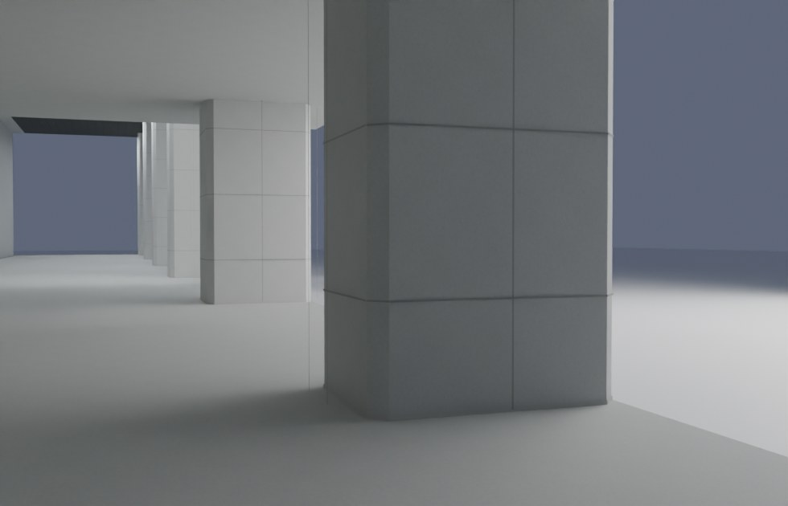
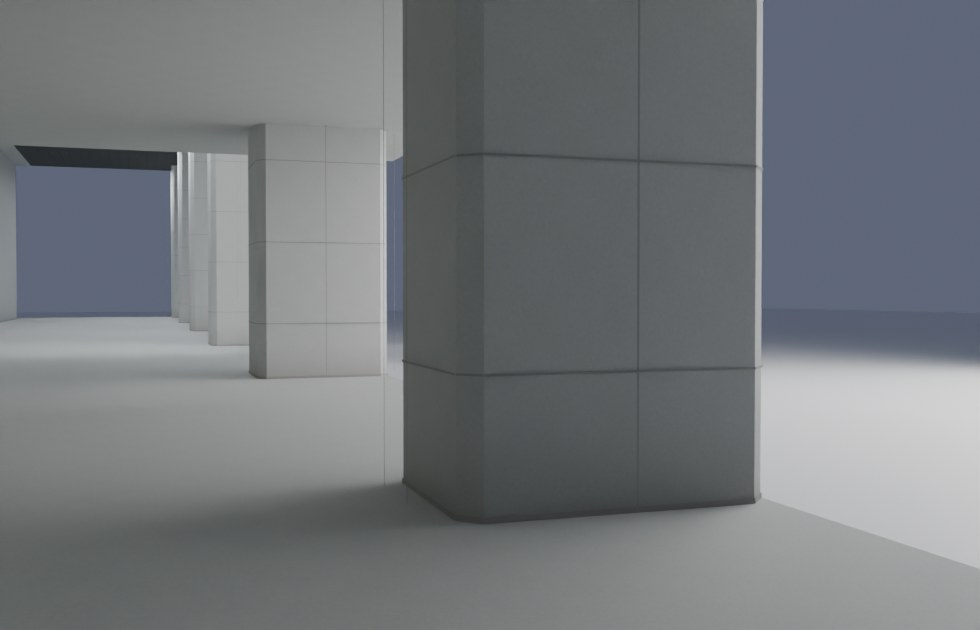

# 세종문화회관 후면 회랑의 석재 하부 마감

## 관찰과 범위

11월 1일 답사 원본 [092](../../20261101답사/KakaoTalk_20261102_024845377_01.webp)와 [095](../../20261101답사/KakaoTalk_20261102_024845377_04.webp)를 실제 열어 대조했다. 두 각도에서 다각 석재 기둥 하부가 중간 면보다 어둡고, 높이와 농도가 같은 반복 띠처럼 보이지 않는다. 상단 석재와 수평 줄눈, 각이 꺾이는 어깨는 이전 모델에서 이미 수정했으므로 그대로 뒀다. 수분에 젖었다고 단정하거나 현장 색·높이·물성으로 표시하지는 않는다. [세종문화회관 공식 건축 외관 자료](https://www.sejongpac.or.kr/portal/cmmn/file/fileDown.do?atchFileId=aeb9ebe4c5a742eab25d3f6a1d2c0a54&bbsId=B0000063&fileSn=1)는 외부 맥락 확인용이며, 뒤쪽 기둥 밑부분의 근거는 답사 사진이다.

| 같은 카메라, 이전 | 같은 카메라, 수정 후 |
|---|---|
|  |  |

[사선에서 본 수정 후 회랑](colonnade-stone-after.jpg). 전후는 같은 Blender 리뷰 카메라, 조명과 중성 바닥에서 실제 배포용 부분 모델을 렌더했다. 리뷰용 조명/바닥은 웹 GLB 또는 편집 모델에 포함되지 않는다. 전체 캠퍼스 배경을 재현한 렌더는 아니다.

## Blender 작업

2026-11-15의 기존 웹 적용 GLB를 Blender 5.3으로 가져와 **편집 가능한 회랑 부분 작업본**을 별도로 만들었다. 기존 통합 캠퍼스 원본은 수정하지 않았다. 통합 석재 메시에서 기존 기둥 7개, 112개 측면 삼각형을 좌표·형상 조건으로 먼저 식별하고 하부에만 3단 분할을 추가했다. 단면, 높이, 배치는 그대로다. 기존 석재 비트맵에 색을 곱해 하부에서 어둡고 조금 따뜻해지도록 하고, 바닥에서 위로 올라갈수록 이전 색에 자연스럽게 돌아오게 했다. 하부 석재 부재 색과 거칠기도 조정했다. 기둥별 경계값과 색값은 사진에 눈대중으로 맞춘 모형 단위다.

새 이미지를 넣지 않고, 기존 텍스처 1개를 원래 바이트 그대로 유지했다. glTF 자동 재질 판정의 첫 내보내기에서 색이 COLOR_1으로 내려가 Three.js의 기본 색 속성에 연결되지 않는 것을 잡았다. 색을 COLOR_0으로 강제하고, 불필요한 추가 색 속성을 끈 뒤 현재 결과를 검증했다.

## 웹 적용과 검증

- 기존 회랑 교체 매니페스트의 정확한 4개 메시 이름·1개 장면, 기존 경로와 변환 유지. 광장 코어, 조명, 보행 충돌이나 실내에는 변경 없음.
- 하부 1.08m 이하의 일곱 기둥에서만 색이 달라진 GLB 정점 592개. 수정 대상 기둥 측면 외 삼각형의 좌표와 이미지 바이트 일치. 삼각형 7,968 → 8,640, GLB 634,592 → 802,292바이트. 이는 회랑 상세 자산의 수치이며 페이지 전체 전송량이 아니다.
- Three.js GLTFLoader 회귀 4개 통과. 실제 GLB의 albedo 맵과 COLOR_0 사용, 4개 이름·원래 변환, 실패 시 메시에 손대지 않는 교체 계약을 확인했다. Node에서는 텍스처 표시 객체를 스텁 처리했고 별도의 브라우저 FPS·운영 화면은 여기서 검증하지 않았다.
- [기하·색 검사 JSON](colonnade-stone-validation.json), [네이티브 회랑 컴포넌트](../../blender_work/20261124-survey/sejong_colonnade_stone_component.blend) 및 [기존 통합 프로젝트 기록](../20261105-unified-building.md).

재현은 원래 부분 GLB를 새 출력과 다른 경로로 보존한 뒤 [Blender 스크립트](../../scripts/refine_colonnade_base_20261124.py)의 CLI를 따른다. 기준 2026-11-15 GLB의 SHA-256은 `dc66bb2086d8f196ca375b785d59da2e19d9ff806bdc485beedad43ab1cfd6cf`이다.
